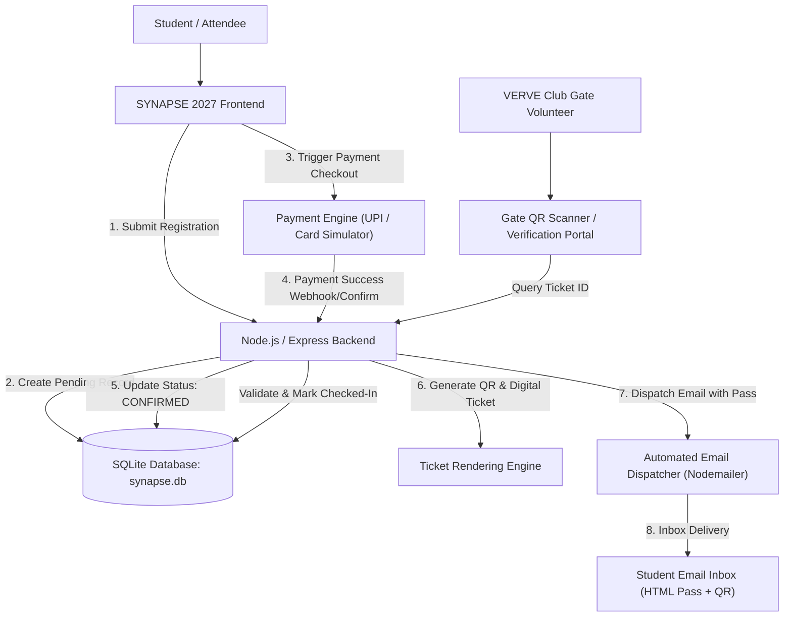

# Product Requirements Document (PRD) — v2.0
## Project: SYNAPSE 2027 — Flagship Tech Fest Web & Registration Platform
### Initiated by: VERVE Club, IILM University, Gurugram
### Designed & Developed by: Mayank

---

## 1. Executive Summary & Vision

### 1.1 Overview
**SYNAPSE 2027** is the annual flagship convergence summit organized by **VERVE Club** at **IILM University, Gurugram**. It bridges cutting-edge software engineering, autonomous robotics, venture creation, and high-octane cultural entertainment over an intense 48-hour timeline.

### 1.2 Core Mission
1. Deliver a unified, immersive cyber-editorial web experience showcasing all 16+ festival events and tracks.
2. Provide an end-to-end automated **Student Registration, Payment Confirmation, and Database Persistence** engine.
3. Automatically generate and dispatch **Verifiable Holographic Digital Tickets with QR Codes via Automated Email** upon payment confirmation.
4. Supply an on-site **Gate Check-in / Ticket Scanner** module for VERVE Club event coordinators to scan and validate student admissions.
5. Anchor branding and attribution: **"Initiated by VERVE Club, IILM University"** and **"Site by Mayank"**.

---

## 2. Updated Scope & System Ecosystem

---

## 3. Detailed Feature Specifications

### 3.1 Frontend Web Portal
- **Hero & Kinetic Broadsheet**: Three.js 3D kinetic wireframe octagon, live telemetry tags, festival metrics (₹5L+ prizes, 48 hours, 5000+ students).
- **About VERVE & IILM**: Mission statement, committee heads, technical clubs network.
- **Tracks & Filterable Events Directory**: 5 tracks (Software, Robotics, Startup, Cultural, Gaming) with rich rulebooks and team format indicators.
- **Schedule**: Multi-day timeline with filterable stages and real-time status markers.
- **Arenas & Showcases**: Robotechthon arena 3D overview, Tech Tank investor lineup, Bollywood Night star reveal.
- **Gallery & FAQs**: High-density interactive archive and campus directions.

### 3.2 Registration & Payment Confirmation Workflow
1. **Student Registration Form**:
   - Fields: Full Name, Student Email, Phone Number, College/University, Roll Number / Student ID, Selected Track / Event, Role (`Hacker`, `Roboticist`, `Pitcher`, `Attendee`), Team Name & Squad Members (if applicable).
2. **Fee Calculation**:
   - General Fest Pass: Free / ₹0
   - Hackathon Squad: ₹499 / team (or subsidized)
   - Robotechthon Combat Bot: ₹799 / bot squad
   - Tech Tank Pitch: ₹299 / startup
   - All-Access VIP + Bollywood Night: ₹399 / student
3. **Payment Processing**:
   - Modern payment modal supporting UPI QR / Intent, Debit/Credit Card, and NetBanking.
   - Idempotent transaction handling with Unique Payment ID `PAY-SYN27-XXXX`.
   - Webhook & verification callback to backend confirming payment capture.

### 3.3 Database Storage & Persistence
- Single self-contained relational database (`synapse.db`) tracking:
  - `registrations`: Student profile, college, role, ticket number, QR hash.
  - `payments`: Transaction ID, amount, method, status (`PENDING`, `CONFIRMED`, `FAILED`), timestamp.
  - `checkins`: Gate scan timestamp, gate operator, status (`VALID`, `ALREADY_CHECKED_IN`, `INVALID`).

### 3.4 Automated Email Delivery System
- Triggered immediately upon payment confirmation.
- Rich HTML email template designed in matching neo-brutalist / cyber-editorial styling:
  - Header: SYNAPSE 2027 | VERVE Club IILM University
  - Prominent Ticket ID: `SYN27-[ALPHANUMERIC]`
  - Embedded high-res QR code with instant gate scan URL
  - Student & Event metadata block (Track, Venue, Entry Gate, Reporting Time)
  - Security hologram watermark and instructions
  - Direct PDF/Print ticket link
  - Mandatory footer: *Initiated by VERVE Club, IILM University | Site by Mayank*.

### 3.5 Gate Verification & Admin Dashboard
- **Admin Portal (`/admin`)**:
  - Live dashboard showing total registrations, revenue collected, category breakdown, and check-in count.
  - Searchable, filterable student registrations table with CSV/Excel export.
- **Gate Check-in Tool (`/verify`)**:
  - Web camera QR code scanner and manual ticket code input.
  - Instant validation feedback (Green: Authorized Entry; Red: Duplicate or Invalid).
  - Updates check-in status in real time to prevent duplicate entry.

---

## 4. Acceptance Criteria & Success Metrics

| Requirement | Target | Verification Method |
| :--- | :--- | :--- |
| **End-to-End Registration** | Under 45 seconds to register & pay | Manual test flow in browser |
| **Payment Confirmation** | < 1s latency to record payment & mark CONFIRMED | Database query verification |
| **Automated Email Dispatch** | Email sent with embedded ticket & QR code within 3 seconds | Automated test & inbox check |
| **Ticket Verification** | Gate scan verifies attendee authenticity and logs check-in | QR scanner test at `/verify` |
| **Attribution & Identity** | Consistent branding: VERVE Club IILM, Site by Mayank | UI and email template audit |
