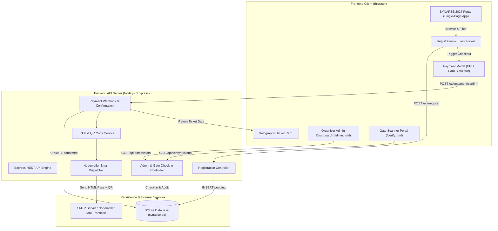

# Technical Requirements Document (TRD) — v2.0
## Project: SYNAPSE 2027 Full-Stack Platform
### Architecture, API, Database, Payment & Email Engine
### Initiator: VERVE Club IILM | Creator: Mayank

---

## 1. System Architecture



---

## 2. Database Schema (SQLite: `synapse.db`)

Using modern Node.js native `node:sqlite` (`DatabaseSync`):

```sql
-- 1. Students & Registrations Table
CREATE TABLE IF NOT EXISTS registrations (
    id INTEGER PRIMARY KEY AUTOINCREMENT,
    ticket_id TEXT UNIQUE NOT NULL,           -- e.g. 'SYN27-8F29A1B4'
    full_name TEXT NOT NULL,
    email TEXT NOT NULL,
    phone TEXT NOT NULL,
    college TEXT NOT NULL,
    student_id TEXT,
    track TEXT NOT NULL,                      -- 'software', 'robotics', 'startup', 'cultural', 'gaming', 'general'
    event_id TEXT NOT NULL,                   -- e.g. 'hackathon-24h', 'robotechthon', 'bollywood-night'
    event_name TEXT NOT NULL,
    role TEXT NOT NULL,                       -- 'Hacker', 'Roboticist', 'Pitcher', 'Attendee'
    team_name TEXT,
    team_members TEXT,                        -- JSON array of member names
    registration_status TEXT DEFAULT 'PENDING',-- 'PENDING', 'CONFIRMED', 'CANCELLED'
    created_at DATETIME DEFAULT CURRENT_TIMESTAMP
);

-- 2. Payments Table
CREATE TABLE IF NOT EXISTS payments (
    id INTEGER PRIMARY KEY AUTOINCREMENT,
    payment_id TEXT UNIQUE NOT NULL,          -- e.g. 'PAY-SYN27-991203'
    ticket_id TEXT NOT NULL,
    amount INTEGER NOT NULL,                  -- in INR (e.g. 499)
    currency TEXT DEFAULT 'INR',
    payment_method TEXT NOT NULL,             -- 'UPI', 'CARD', 'NETBANKING', 'FREE'
    payment_status TEXT DEFAULT 'PENDING',    -- 'PENDING', 'CAPTURED', 'FAILED'
    transaction_ref TEXT,
    captured_at DATETIME,
    FOREIGN KEY(ticket_id) REFERENCES registrations(ticket_id)
);

-- 3. Gate Check-ins Table
CREATE TABLE IF NOT EXISTS checkins (
    id INTEGER PRIMARY KEY AUTOINCREMENT,
    ticket_id TEXT NOT NULL,
    gate_name TEXT DEFAULT 'Main Gate 01',
    scanned_by TEXT DEFAULT 'VERVE Coordinator',
    scanned_at DATETIME DEFAULT CURRENT_TIMESTAMP,
    FOREIGN KEY(ticket_id) REFERENCES registrations(ticket_id)
);
```

---

## 3. REST API Specifications

### 3.1 Public Endpoints
- **`POST /api/register`**
  - **Body**: `{ fullName, email, phone, college, studentId, track, eventId, eventName, role, teamName, teamMembers, amount }`
  - **Action**: Generates cryptographic `ticket_id` (`SYN27-[HEX]`), inserts into `registrations` as `PENDING`, creates associated pending payment.
  - **Response**: `{ success: true, ticketId, amount, paymentId }`

- **`POST /api/payment/confirm`**
  - **Body**: `{ ticketId, paymentId, paymentMethod, transactionRef }`
  - **Action**:
    1. Validates transaction and updates `payment_status = 'CAPTURED'`.
    2. Updates `registration_status = 'CONFIRMED'`.
    3. Generates QR Code data URL encoding verification URL.
    4. Automatically dispatches HTML ticket email via Nodemailer.
  - **Response**: `{ success: true, ticket: { ticketId, qrDataUrl, ... }, emailSent: true, emailPreviewUrl?: string }`

- **`GET /api/ticket/:ticketId`**
  - **Action**: Fetches confirmed registration, payment status, and verification QR code.
  - **Response**: `{ success: true, ticket: { ... } }`

### 3.2 Gate Verification & Admin Endpoints
- **`GET /api/verify/:ticketId`**
  - **Action**: Used by gate camera QR scanner. Validates if ticket is valid and whether the student is already checked in.
  - **Response**: `{ valid: true, ticket: { ... }, alreadyCheckedIn: boolean, checkinTime: string | null }`

- **`POST /api/checkin/:ticketId`**
  - **Action**: Records physical gate entry in `checkins`.
  - **Response**: `{ success: true, message: 'Check-in recorded' }`

- **`GET /api/admin/stats`**
  - **Action**: Aggregates total registrations, total revenue, check-in count, and track breakdown.
  - **Response**: `{ totalRegistrations, totalRevenue, totalCheckins, trackCounts, recentRegistrations }`

- **`GET /api/admin/registrations`**
  - **Action**: Returns full list of registrations with payment status and export support.

---

## 4. Automated Email Delivery Engine

- **Service**: Nodemailer with SMTP transport.
- **Development & Live Support**:
  - In development / demo mode: Automatically creates an **Ethereal Email test account**, allowing instant one-click browser preview of sent emails without external SMTP credentials.
  - In production mode: Reads standard SMTP credentials from `.env` (`SMTP_HOST`, `SMTP_PORT`, `SMTP_USER`, `SMTP_PASS`, `FROM_EMAIL`).
- **Email Template Features**:
  - High-voltage brutalist design matching `DESIGN.md`.
  - Embedded ticket details: Student name, College, Event/Track, Unique Serial Number.
  - Embedded high-res QR code image for gate scanning.
  - Instructions for campus entry, reporting time, and ID proof requirements.
  - Mandatory attribution: *Initiated by VERVE Club, IILM University | Site by Mayank*.

---

## 5. Security & Data Integrity

- **Idempotency**: Prevent double payments or double confirmations for the same ticket ID.
- **Duplicate Prevention**: Unique constraint on `ticket_id` and indexed email checks.
- **XSS & Injection Protection**: Parameterized SQL queries using `node:sqlite` statement bindings (`db.prepare('...').run(...)`).
- **CORS & Headers**: Strict CORS headers and sanitized request bodies.
